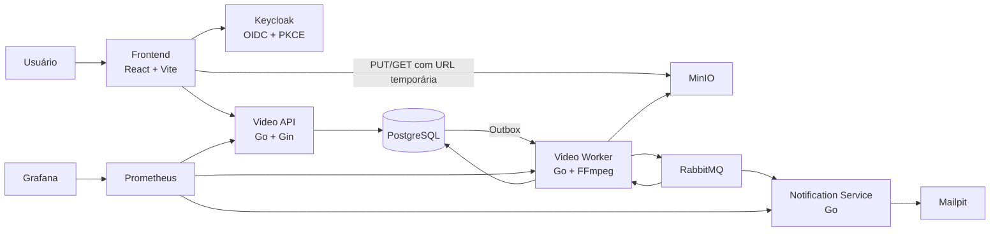
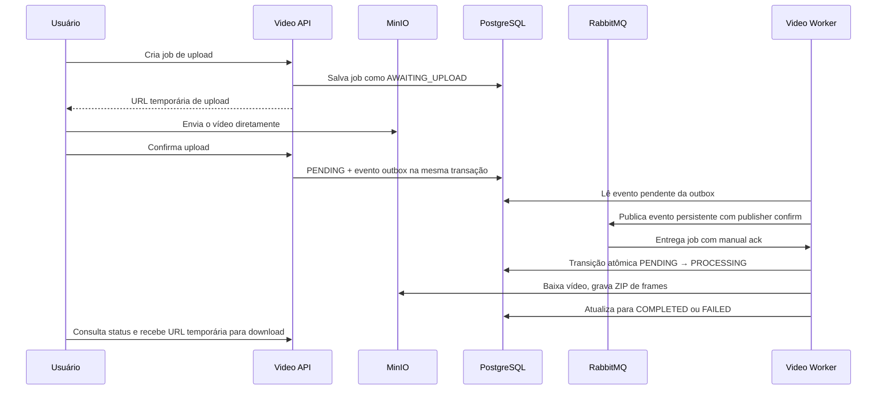

# FIAP X — Plataforma de processamento de vídeos

Plataforma local para transformar vídeos em imagens. O usuário autentica-se, envia um ou mais vídeos, acompanha o processamento assíncrono e baixa um ZIP com os frames gerados.

O projeto preserva os pedidos confirmados mesmo quando API, worker ou RabbitMQ reiniciam: o estado do trabalho fica no PostgreSQL e a publicação para a fila usa o padrão **Transactional Outbox**.

## Arquitetura proposta



| Componente | Responsabilidade |
| --- | --- |
| Frontend | Login, seleção múltipla de vídeos, acompanhamento de status e download. |
| Keycloak | Identidade, cadastro/login e emissão de tokens OIDC para o frontend. |
| Video API | Valida o pedido, controla acesso por usuário, cria URLs temporárias do MinIO e expõe a listagem de vídeos. |
| PostgreSQL | Fonte de verdade dos jobs, estados e eventos pendentes da outbox. |
| MinIO | Armazena fontes e ZIPs de resultado de maneira privada. |
| RabbitMQ | Fila durável de pedidos de processamento e eventos de falha. |
| Video Worker | Extrai um frame por segundo com FFmpeg, monta o ZIP e atualiza o status do job. |
| Notification Service + Mailpit | Envia e permite inspecionar localmente e-mails de falha. |
| Prometheus + Grafana | Coleta e exibe saúde e métricas dos serviços e do fluxo. |

### Fluxo de processamento



### Estados de um vídeo

| Status | Significado |
| --- | --- |
| `AWAITING_UPLOAD` | Job criado; o arquivo ainda não foi confirmado no MinIO. |
| `PENDING` | Upload confirmado e aguardando consumo pelo worker. |
| `PROCESSING` | Worker está extraindo imagens e montando o ZIP. |
| `COMPLETED` | ZIP disponível para download pelo proprietário. |
| `FAILED` | O processamento falhou; o motivo fica disponível na listagem e gera e-mail. |

## Pré-requisitos

- Docker Desktop, Docker Engine ou Docker Compose v2;
- portas locais livres: `5173`, `8080`, `8083`, `9000`, `9001`, `15672`, `8025`, `9090` e `3300`.

Não é necessário instalar Go, Node.js, FFmpeg, PostgreSQL ou RabbitMQ na máquina host.

## Como executar localmente

1. Clone o repositório e entre na pasta do projeto.

   ```bash
   git clone https://github.com/gustavodetoni/tech-challenge-hackathon.git
   cd tech-challenge-hackathon
   ```

2. Crie o arquivo de ambiente local.

   ```bash
   cp .env.example .env
   ```

3. Suba todos os serviços e gere as imagens.

   ```bash
   docker compose up -d --build
   ```

4. Aguarde os healthchecks e confirme o estado.

   ```bash
   docker compose ps
   ```

   Espere `healthy` para PostgreSQL, RabbitMQ, MinIO, Video API e frontend. O container `minio-init` deve aparecer como `Exited (0)`: ele é um job único que cria os buckets `video-inputs` e `video-results`.

5. Acesse o frontend em [http://localhost:5173](http://localhost:5173) e entre com:

   ```text
   usuário: admin
   senha: fiap123
   ```

Você também pode criar um usuário no Keycloak. O nome informado no cadastro será exibido no painel.

## Serviços locais e acessos

| Serviço | Link local | Login |
| --- | --- | --- |
| Frontend | [localhost:5173](http://localhost:5173) | `admin` / `fiap123` |
| Video API | [localhost:8080/api/v1/ping](http://localhost:8080/api/v1/ping) | Token OIDC no header `Authorization: Bearer` |
| Swagger | [localhost:8080/swagger/index.html](http://localhost:8080/swagger/index.html) | — |
| Keycloak | [localhost:8083](http://localhost:8083) | administração: `admin` / `fiap123` |
| RabbitMQ Management | [localhost:15672](http://localhost:15672) | `admin` / `fiap123` |
| MinIO Console | [localhost:9001](http://localhost:9001) | `admin` / `fiap1234` |
| MinIO S3 API | [localhost:9000](http://localhost:9000) | `admin` / `fiap1234` |
| Mailpit | [localhost:8025](http://localhost:8025) | sem autenticação |
| Prometheus | [localhost:9090](http://localhost:9090) | sem autenticação |
| Grafana | [localhost:3300](http://localhost:3300) | `admin` / `fiap123` |

As credenciais são apenas para desenvolvimento local. Elas podem ser alteradas em `.env` antes da primeira subida. Para que serviços que persistem configuração adotem novas credenciais, recrie os volumes conforme a seção de reset.

## Como testar o fluxo manualmente

1. Faça login no frontend.
2. Selecione um ou mais vídeos MP4, MOV, AVI, MKV ou WebM.
3. Clique em **Enviar para processamento**.
4. Observe a mudança de status em **Meus vídeos**: fila → processando → concluído.
5. Quando concluído, clique em **Baixar ZIP** e valide os frames JPG.
6. Acompanhe a mensagem em `video.processing.jobs` pelo RabbitMQ e os objetos nos buckets do MinIO.

Para testar o fluxo de falha e o e-mail, envie um vídeo válido cujo nome comece com `force-failure-`, por exemplo `force-failure-teste.mov`. Essa é uma chave exclusiva do ambiente local, configurada por `WORKER_FORCE_FAILURE_PREFIX`; não deve ser habilitada em produção. O job ficará como `FAILED` e o e-mail poderá ser visto no Mailpit.

## Observabilidade e diagnóstico

- Grafana já possui datasource do Prometheus provisionado. Acesse [http://localhost:3300](http://localhost:3300) para acompanhar saúde, jobs por status, outbox pendente e métricas do worker.
- Prometheus permite consultar as métricas brutas em [http://localhost:9090](http://localhost:9090).
- Logs de um serviço:

  ```bash
  docker compose logs -f video-api
  docker compose logs -f video-worker
  docker compose logs -f notification-service
  ```

- Healthchecks principais:

  ```bash
  curl http://localhost:8080/health/live
  curl http://localhost:8080/health/ready
  curl http://localhost:8080/api/v1/ping
  ```

Se uma porta estiver ocupada, identifique o processo que a utiliza ou altere o mapeamento no arquivo Compose. Para reiniciar apenas o frontend após alterações visuais:

```bash
docker compose up -d --build frontend
```

## Qualidade e testes

Os serviços Go possuem testes unitários de domínio com mínimo de 80% por pacote coberto. Para executar a verificação local:

```bash
bash scripts/check-unit-coverage.sh
```

Para executar toda a suíte e validar o Compose:

```bash
(cd services/video-api && go test -race ./...)
(cd services/video-worker && go test -race ./...)
(cd services/notification-service && go test -race ./...)
(cd frontend && pnpm install --frozen-lockfile && pnpm run build)
docker compose --env-file .env.example config --quiet
```

O GitHub Actions executa `go vet`, testes com race detector, a verificação de cobertura, build do frontend e build do Compose.

## Parar ou resetar o ambiente

Para parar preservando dados:

```bash
docker compose down
```

Para parar e remover todos os dados locais — PostgreSQL, RabbitMQ, MinIO, Keycloak, Prometheus e Grafana — execute:

```bash
docker compose down -v
```

> Atenção: o último comando é destrutivo. Na próxima execução, use novamente `docker compose up -d --build`.
