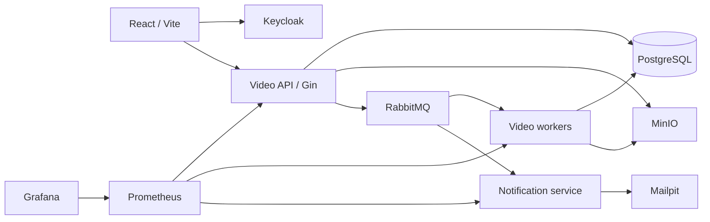
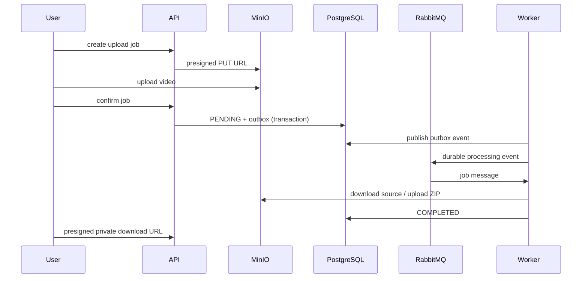

# FIAP X — Plataforma de Vídeos

Plataforma local de processamento assíncrono de vídeos: autenticação, upload privado, fila, extração de frames, ZIP e download autorizado.

## Arquitetura





## Pré-requisitos

Somente Docker Engine com Docker Compose v2. Não é necessário instalar Go, Node.js ou FFmpeg na máquina host.

## Como executar

1. Copie o arquivo de ambiente: `cp .env.example .env`.
2. Se desejar, troque as senhas locais no `.env`.
3. Suba tudo: `docker compose up -d --build`.
4. Confira a saúde: `docker compose ps`.

O Compose principal inclui a infraestrutura, os serviços e a observabilidade. Os dados ficam em volumes nomeados e são preservados em `docker compose down`.

## Endereços locais

| Serviço | Endereço | Credenciais locais |
| --- | --- | --- |
| Frontend | http://localhost:5173 | — |
| API | http://localhost:8080/api/v1/ping | — |
| Swagger | http://localhost:8080/swagger/index.html | — |
| Keycloak | http://localhost:8083 | `KEYCLOAK_ADMIN` / `KEYCLOAK_ADMIN_PASSWORD` do `.env` |
| RabbitMQ Management | http://localhost:15672 | `RABBITMQ_DEFAULT_USER` / `RABBITMQ_DEFAULT_PASS` do `.env` |
| MinIO Console | http://localhost:9001 | `admin` / `fiap1234` (mínimo de 8 caracteres exigido pelo MinIO) |
| Prometheus | http://localhost:9090 | — |
| Grafana | http://localhost:3300 | `admin` / `fiap123` |

Após a primeira inicialização, o realm `fiap-video` e o cliente público `fiap-video-spa` estão disponíveis no Keycloak. O cliente usa Authorization Code com PKCE e o frontend utiliza os access tokens emitidos para falar com a API.

Entre pelo frontend usando `admin` / `fiap123`. O upload aceita MP4, MOV, AVI, MKV e WebM até o limite de `MAX_UPLOAD_BYTES`.

O processamento é assíncrono: após a confirmação, o worker gera frames JPG a 1 FPS e um ZIP privado. A UI mostra estados e libera download somente em `COMPLETED`. Para escalar localmente, execute `docker compose up -d --build --scale video-worker=3`; acompanhe a fila em RabbitMQ Management.

## Verificação manual

```sh
curl http://localhost:8080/health/live
curl http://localhost:8080/health/ready
curl http://localhost:8080/api/v1/ping
docker compose config
```

## Resetar o ambiente local

Para remover também todos os dados locais persistidos (PostgreSQL, RabbitMQ, MinIO, Keycloak, Prometheus e Grafana):

```sh
docker compose down -v
```

Isso é destrutivo e apropriado apenas para desenvolvimento. Para reiniciar preservando dados, use `docker compose down` seguido de `docker compose up -d`.
